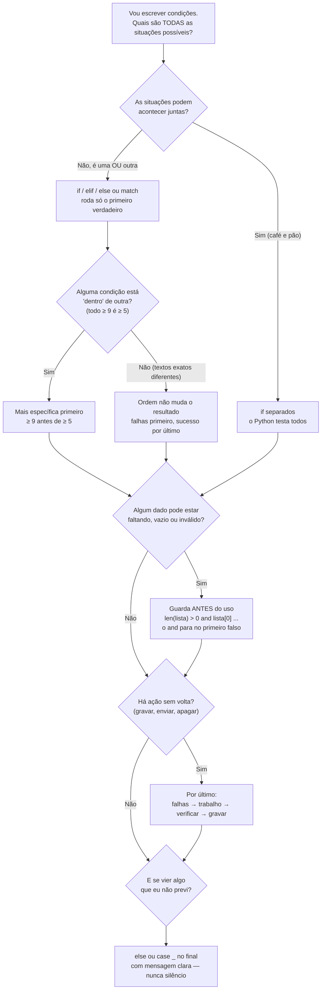

# Roteiro: antes de escrever condições

Este é o **mapa de decisão**, que complementa o passo a passo interativo (`condicionais-passo-a-passo.html`). O passo a passo mostra **como o Python executa** as condições, linha por linha. O mapa mostra **como você escolhe a estrutura** antes de escrever o código.

**Texto alternativo (mesmo conteúdo do diagrama):**

1. **Liste todas as situações.** Exemplo do seu projeto: arquivo não existe, arquivo vazio, arquivo com dados.
2. **Elas podem acontecer juntas?** Se sim, use `if` separados. Se é uma **ou** outra, use `if/elif/else` ou `match`.
3. **Alguma condição está dentro de outra?** Se sim, a mais específica vem primeiro. Se não, a ordem não muda o resultado: organize com as falhas primeiro e o sucesso por último.
4. **Algum dado pode estar faltando ou vazio?** Ponha a guarda **antes** do uso, por exemplo `len(lista) > 0 and lista[0] ...`.
5. **Existe ação sem volta** (gravar, enviar, apagar)? Ela vem **por último**, depois de verificar.
6. **E se vier algo que você não previu?** Ponha um `else` ou `case _` no final, com mensagem clara.

## Para fixar (responda antes de abrir o passo a passo de novo)

1. Por que, no `match` com as mensagens do `ler_ordens.py`, a ordem dos `case` não muda o resultado?
2. Por que `fila[0] == "Ana" and len(fila) > 0` quebra com a lista vazia, e `len(fila) > 0 and fila[0] == "Ana"` não quebra?
3. Explique a um colega, sem código, por que o `ordens.json` virou `[]` quando o CSV sumiu.

Fontes: Python Tutorial, cap. 4 (*More Control Flow Tools*) e cap. 8 (*Errors and Exceptions*); Built-in Types, *Boolean Operations*. Material de estudo: **não é evidência**. O que conta é você explicar e aplicar depois.
